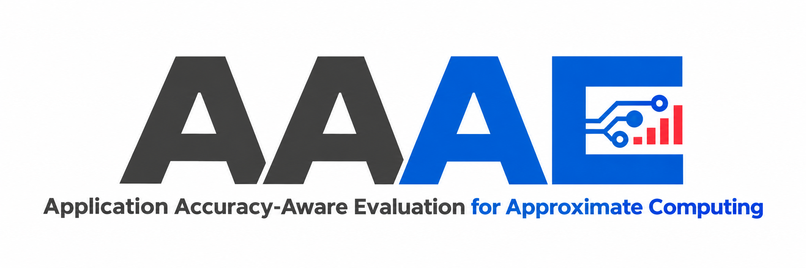

<p align="center">
  
</p>

<p align="center">
  
  
  
  
</p>

<p align="center">
  <a href="#-quick-start"><strong>Quick Start</strong></a> ·
  <a href="#-supported-models"><strong>Supported Models</strong></a> ·
  <a href="docs/methodology.md"><strong>Methodology</strong></a> ·
  <a href="examples/README.md"><strong>Examples</strong></a> ·
  <a href="docs/usage.md"><strong>Usage Guide</strong></a>
</p>

**Find efficient approximate multipliers under application-level accuracy constraints.** AAAE predicts how a multiplier affects neural-network accuracy, estimates its hardware cost, and supports design search and verification. It covers three vision Transformers and two CNNs, with model-specific accuracy predictors and a shared multiplier representation.

> [!NOTE]
> This repository contains the AAAE accuracy-prediction and optimization source code, examples, and configuration files. Datasets, model packages, checkpoints, and technology libraries are supplied separately. Configure their locations in [`configs/paths.json`](configs/paths.json) before running stages that require them.

## ✨ Highlights

<table>
  <tr>
    <td width="50%" valign="top">
      <h3>🎯 Application Accuracy Prediction</h3>
      <p>Model-specific LightGBM predictors for Swin, ViT, and DeiT combine static error features, model conditioning, and a fixed 50-image response. ResNet and MobileNet use two-member CNN predictors.</p>
      <a href="aaae/accuracy_predictor/">Accuracy predictors →</a>
    </td>
    <td width="50%" valign="top">
      <h3>🧩 Configurable Multipliers</h3>
      <p>Choose from eight approximate compressors at nine low-order positions, while keeping high-order compression exact. Generate RTL, complete truth tables, and signed residual lookup tables.</p>
      <a href="aaae/multiplier_generator/">Multiplier generation →</a>
    </td>
  </tr>
  <tr>
    <td width="50%" valign="top">
      <h3>⚡ Hardware-Cost Estimation</h3>
      <p>A stage-wise GraphSAGE model predicts power, delay, and area from compressor graphs. Rank designs by power–delay product and verify hardware cost with the no-macro EDA flow.</p>
      <a href="aaae/multiplier_gnn/">Hardware predictor →</a> · <a href="aaae/hardware_evaluation/">EDA verification →</a>
    </td>
    <td width="50%" valign="top">
      <h3>🔎 Accuracy-Constrained Optimization</h3>
      <p>Explore designs with three-objective Bayesian optimization and NSGA-II. Use independent A1 calibration and fixed-pool selection to enforce an accuracy admission rule with a bounded query budget.</p>
      <a href="aaae/optimization_algorithm/">Design search →</a> · <a href="aaae/design_selection/">Budgeted selection →</a>
    </td>
  </tr>
</table>

## 🚀 Quick Start

### 1. Install

Use Python **3.10 or newer**. Create the environment from the repository root:

```bash
git clone https://github.com/ShenShan123/AAAE.git
cd AAAE

conda env create -f environment.yml
conda activate pytorch
python -m pip install -e . --no-deps
```

<details>
<summary><strong>Already have a Python environment?</strong></summary>

Install the dependencies and package in your active environment:

```bash
python -m pip install -r requirements.txt
python -m pip install -e . --no-deps
```

The example scripts also run directly from the checkout when their dependencies are installed.

</details>

### 2. Configure External Resources

Edit [`configs/paths.json`](configs/paths.json) to point to your experiment assets and hardware resources:

```json
{
  "external_root": "/path/to/experiment_assets",
  "output_root": "output",
  "ppa_root": "/path/to/ppa"
}
```

External assets must retain the directory layout described in the [resource configuration guide](docs/usage.md#resource-configuration). You can override these paths with `AAAE_EXTERNAL_ROOT`, `AAAE_OUTPUT_ROOT`, and `AAAE_PPA_ROOT`.

### 3. Generate Your First Multiplier

Select one compressor ID from `1..8` for each of the nine low-order positions:

```bash
python examples/generate_multiplier.py \
    --compressors 1 2 3 4 5 6 7 8 1 \
    --output output/multiplier/multiplier.v
```

**Output:** an approximate 8-bit multiplier in Verilog, with exact high-order compression. This step uses the source code without external datasets or model checkpoints.

<details>
<summary><strong>Requirements for inference and hardware verification</strong></summary>

| Stage | Additional requirements |
| --- | --- |
| Approximate inference | CUDA, nvcc, and ONNX Runtime GPU with matching SDK headers |
| Transformer CUDA operator build | CMake |
| Hardware verification | Yosys, OpenSTA, VCS, and Nangate standard-cell resources |

See the [usage guide](docs/usage.md) for tool paths, input schemas, and model-package requirements.

</details>

## 🧠 Supported Models

| Family | Model | Accuracy predictor | Candidate response |
| --- | --- | --- | --- |
| Transformer | **Swin-Tiny** | Model-specific LightGBM | 50 labeled images |
| Transformer | **ViT-Base** | Model-specific LightGBM | 50 labeled images |
| Transformer | **DeiT-Base** | Model-specific LightGBM | 50 labeled images |
| CNN | **ResNet-50** | Two-member Delta-CNN | None |
| CNN | **MobileNetV3-Large** | Two-member Correctness-CNN with disagreement postprocessing | None |

Transformer predictors fuse **3103 static**, **1034 conditioned**, and **360 response** features into a **4497-dimensional** input. CNN predictors use engineered features and residual encodings without a candidate-level inference response.

Full accuracy measurement injects a candidate residual LUT into **48** weight-bearing Linear MatMuls per Transformer, **53** Conv nodes in ResNet-50, or **62** Conv nodes in MobileNetV3-Large. See [methodology and paper correspondence](docs/methodology.md) for the representations and evaluation protocol.

## 🛠️ Training, Search, and Verification

Run commands from the repository root. Each entry point exposes `--help`; model-specific options follow `--`.

<details>
<summary><strong>🎯 Train, predict, and evaluate accuracy</strong></summary>

Inspect feature preparation and train the ViT structure-aware predictor with the required datasets, base response package, and conditioned features configured:

```bash
python examples/prepare_features.py --help
python examples/train_accuracy.py --model vit_base -- --help

python examples/train_accuracy.py \
    --model vit_base -- \
    --lgbm-device cpu \
    --jobs 12
```

Predict with a Transformer package and its matching 4497-dimensional feature matrix, then evaluate paired measured and predicted drops:

```bash
python examples/predict_accuracy.py \
    --family transformer \
    --package /path/to/strict50_package \
    --features /path/to/features.npy \
    --output output/accuracy/predictions.csv

python examples/evaluate_accuracy.py \
    --predictions /path/to/holdout_predictions.csv \
    --units proportion
```

Model keys: `swin_tiny`, `vit_base`, `deit_base`, `resnet50`, and `mobilenetv3`. CNN training produces individual members; the bundle-building step combines them into the final predictor. Evaluation reports MAE, P95, and maximum absolute error in percentage points. Use `--units pp` if the input already uses those units.

→ [Accuracy prediction guide](docs/usage.md#accuracy-prediction)

</details>

<details>
<summary><strong>🔎 Explore designs with BO and NSGA-II</strong></summary>

Both iterative optimizers currently use the **Swin-Tiny Linear48** predictor and evaluate Top-1 accuracy drop, PDP, and area.

```bash
python examples/run_bo.py --help
python examples/run_nsga2.py --help

python examples/run_bo.py \
    --run-name swin_bo_20k \
    --device cuda:0 \
    --bo-iterations 20000 \
    --max-new-evals 20000
```

The BO example requests a budget of 20,000 unique evaluations. Calibrated fixed-pool selection is a separate workflow, described below.

→ [Design optimization guide](docs/usage.md#iterative-optimization)

</details>

<details>
<summary><strong>📐 Calibrate and select under an accuracy budget</strong></summary>

Fit an A1 empirical correction using independent calibration labels and target-pool bins. Then plan at most ten full accuracy queries under a two-percentage-point accuracy-drop budget:

```bash
python examples/calibrate.py \
    --model swin_tiny \
    --calibration /path/to/calibration.csv \
    --pool /path/to/candidate_pool.csv \
    --alpha 0.10 \
    --output output/calibration/swin_a1.json

python examples/select_design.py \
    --pool /path/to/candidate_pool.csv \
    --correction output/calibration/swin_a1.json \
    --tau 2.0 \
    --budget 10 \
    --output-dir output/selection/swin
```

Candidates pass admission when their calibrated upper drop is within the budget; admitted candidates are ordered by predicted PDP. Selection retains the query limit and abstention behavior. A1 is an empirical correction without a finite-sample coverage guarantee.

→ [Calibration and selection guide](docs/usage.md#calibration-and-selection)

</details>

<details>
<summary><strong>✅ Verify accuracy and hardware cost</strong></summary>

```bash
python examples/verify_designs.py --family transformer -- --help
python examples/verify_designs.py --family cnn -- --help
python examples/run_ppa.py --help
```

Rerun selected designs under the fixed inference protocol and measure hardware cost with the no-macro EDA flow. This stage requires the corresponding inference assets and EDA tools.

→ [Verification guide](docs/usage.md#verification)

</details>

## 📁 Repository Structure

```text
AAAE/
├── aaae/
│   ├── multiplier_generator/       # RTL, truth tables, and signed residual LUTs
│   ├── accuracy_predictor/         # Features, Transformer/CNN predictors, training
│   ├── inference_runtime/          # LUT injection, CUDA operators, accuracy measurement
│   ├── multiplier_gnn/             # Graph encoding and hardware-cost prediction
│   ├── hardware_evaluation/        # Synthesis, timing, and power verification
│   ├── optimization_algorithm/     # Bayesian optimization and NSGA-II
│   ├── calibration/                # A1 empirical upper corrections
│   ├── design_selection/           # Accuracy admission and budgeted selection
│   └── evaluation/                 # Prediction metrics and accuracy verification
├── examples/                       # Executable entry points
├── configs/                        # External resource and output paths
├── docs/                           # Methodology, usage, and README assets
├── environment.yml
├── requirements.txt
└── pyproject.toml
```

## 📚 Documentation

| Start here | What you will find |
| --- | --- |
| [Methodology](docs/methodology.md) | Paper correspondence, feature definitions, model architectures, and evaluation protocols |
| [Usage Guide](docs/usage.md) | External resources, input schemas, training, prediction, calibration, and verification |
| [Examples](examples/README.md) | Command-line entry points for each supported operation |
| [Path Configuration](configs/paths.json) | Locations for external assets and generated outputs |
